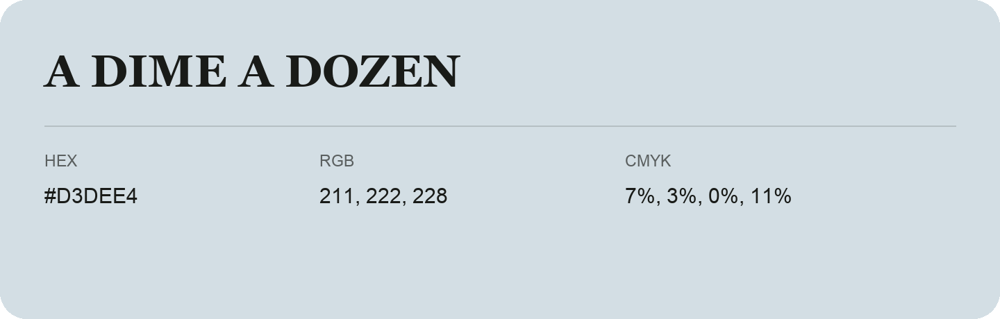

## A Dime A Dozen

- HEX: #D3DEE4
- RGB: 211, 222, 228
- CMYK: 7%, 3%, 0%, 11%
- Character: quiet, balanced, understated
- Suggested uses: professional services, minimal identities, supporting backgrounds

- Source images: iCloud Photos 2/IMG_9156.JPG
