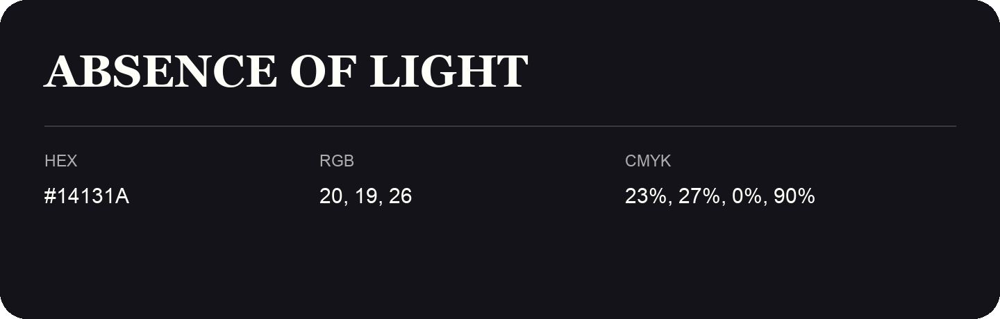

## Absence Of Light

- HEX: #14131A
- RGB: 20, 19, 26
- CMYK: 23%, 27%, 0%, 90%
- Character: cool, composed, dependable
- Suggested uses: professional services, technology brands, calm backgrounds

- Source images: IMG_9018.JPG
