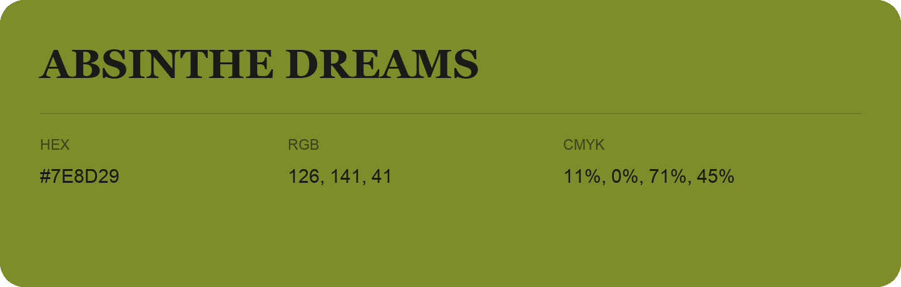

## Absinthe Dreams

- HEX: #7E8D29
- RGB: 126, 141, 41
- CMYK: 11%, 0%, 71%, 45%
- Character: sunny, lively, optimistic
- Suggested uses: friendly consumer brands, food packaging, cheerful accents

- Source images: iCloud Photos 2/IMG_9139.JPG
