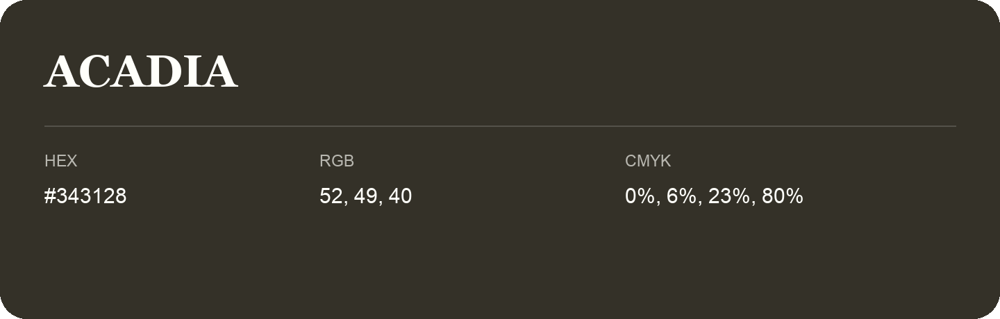

## Acadia

- HEX: #343128
- RGB: 52, 49, 40
- CMYK: 0%, 6%, 23%, 80%
- Character: sunny, lively, optimistic
- Suggested uses: friendly consumer brands, food packaging, cheerful accents

- Source images: IMG_9051.JPG
