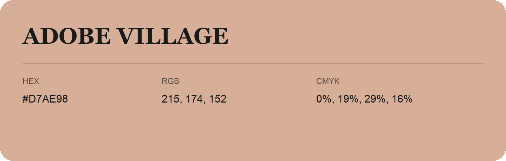

## Adobe Village

- HEX: #D7AE98
- RGB: 215, 174, 152
- CMYK: 0%, 19%, 29%, 16%
- Character: soft, gentle, approachable
- Suggested uses: friendly consumer brands, gentle backgrounds, welcoming accents

- Source images: iCloud Photos 2/IMG_9169.JPG
