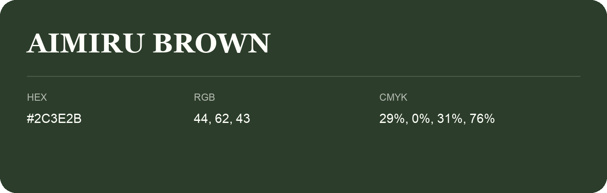

## Aimiru Brown

- HEX: #2C3E2B
- RGB: 44, 62, 43
- CMYK: 29%, 0%, 31%, 76%
- Character: deep, grounded, understated
- Suggested uses: premium packaging, editorial typography, dark backgrounds

- Source images: iCloud Photos 2/IMG_9159.JPG

- Name note: Other distinct shades share this name: [aimiru-brown](aimiru-brown.md).
