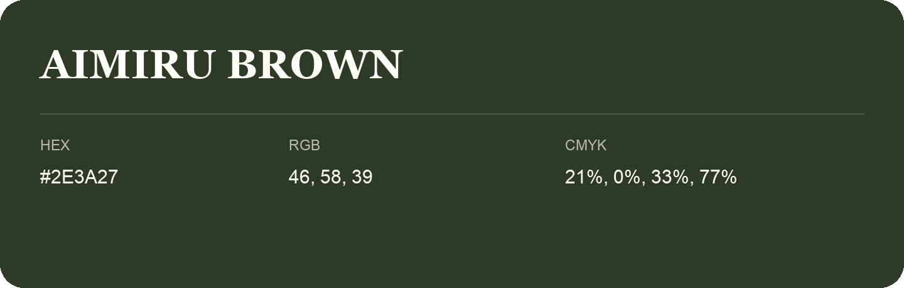

## Aimiru Brown

- HEX: #2E3A27
- RGB: 46, 58, 39
- CMYK: 21%, 0%, 33%, 77%
- Character: natural, grounded, fresh
- Suggested uses: outdoor businesses, wellness brands, organic packaging

- Source images: IMG_9021.JPG

- Name note: Other distinct shades share this name: [aimiru-brown-2c3e2b](aimiru-brown-2c3e2b.md).
