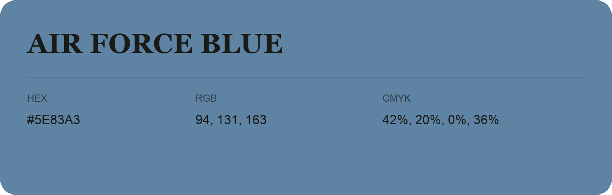

## Air Force Blue

- HEX: #5E83A3
- RGB: 94, 131, 163
- CMYK: 42%, 20%, 0%, 36%
- Character: cool, composed, dependable
- Suggested uses: professional services, technology brands, calm backgrounds

- Source images: IMG_8987.JPG

- Data provenance: HEX recovered from page data; cross-checked against the readable source RGB.
