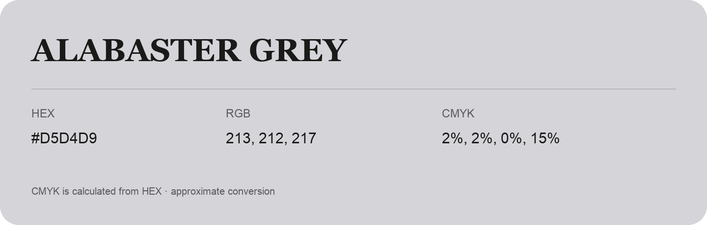

## Alabaster Grey

- HEX: #D5D4D9
- RGB: 213, 212, 217
- CMYK: 2%, 2%, 0%, 15%
- Character: quiet, balanced, understated
- Suggested uses: professional services, minimal identities, supporting backgrounds

- Source images: IMG_8983.JPG

- Data provenance: CMYK calculated from HEX using the page’s conversion; source image CMYK was unreadable. This is an approximate conversion without a print color profile.

- Name note: Other distinct shades share this name: [alabaster-grey-e2dde3](alabaster-grey-e2dde3.md).
