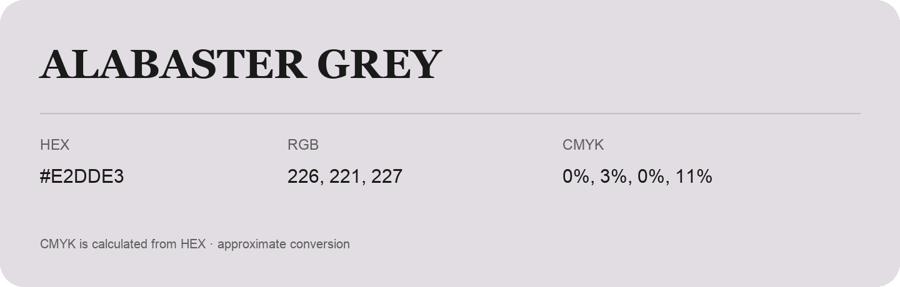

## Alabaster Grey

- HEX: #E2DDE3
- RGB: 226, 221, 227
- CMYK: 0%, 3%, 0%, 11%
- Character: quiet, balanced, understated
- Suggested uses: professional services, minimal identities, supporting backgrounds

- Source images: IMG_8992.JPG

- Data provenance: CMYK calculated from HEX using the page’s conversion; source image CMYK was unreadable. This is an approximate conversion without a print color profile.

- Name note: Other distinct shades share this name: [alabaster-grey-d5d4d9](alabaster-grey-d5d4d9.md).
