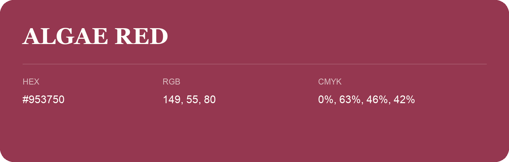

## Algae Red

- HEX: #953750
- RGB: 149, 55, 80
- CMYK: 0%, 63%, 46%, 42%
- Character: expressive, imaginative, refined
- Suggested uses: beauty brands, creative businesses, distinctive accents

- Source images: iCloud Photos 2/IMG_9161.JPG
