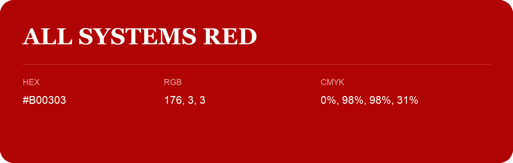

## All Systems Red

- HEX: #B00303
- RGB: 176, 3, 3
- CMYK: 0%, 98%, 98%, 31%
- Character: warm, expressive, energetic
- Suggested uses: food brands, expressive identities, promotional accents

- Source images: iCloud Photos 2/IMG_9154.JPG
