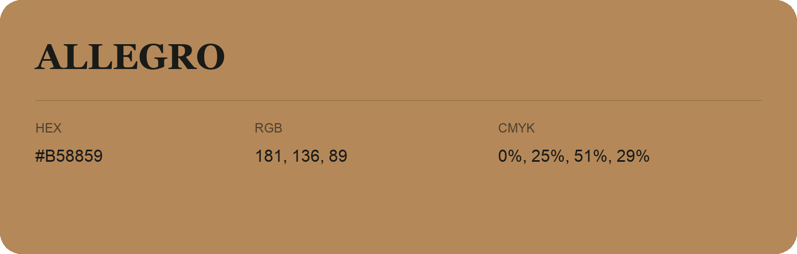

## Allegro

- HEX: #B58859
- RGB: 181, 136, 89
- CMYK: 0%, 25%, 51%, 29%
- Character: earthy, rich, warm
- Suggested uses: artisan businesses, hospitality brands, warm accents

- Source images: iCloud Photos 2/IMG_9169.JPG
