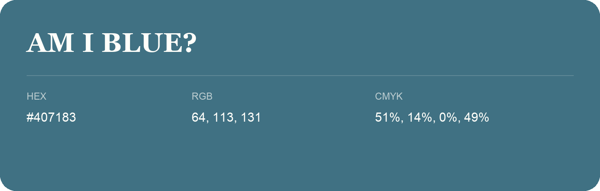

## Am I Blue?

- HEX: #407183
- RGB: 64, 113, 131
- CMYK: 51%, 14%, 0%, 49%
- Character: calm, fresh, composed
- Suggested uses: wellness brands, coastal hospitality, modern service brands

- Source images: IMG_9036.JPG
