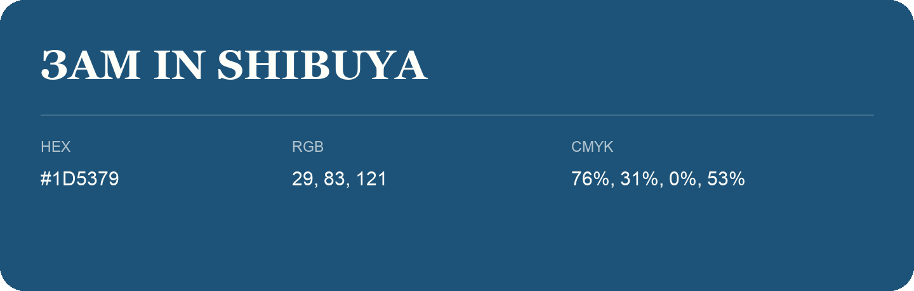

## Зam In Shibuya

- HEX: #1D5379
- RGB: 29, 83, 121
- CMYK: 76%, 31%, 0%, 53%
- Character: cool, composed, dependable
- Suggested uses: professional services, technology brands, calm backgrounds

- Source images: IMG_9081.JPG

- Data provenance: HEX recovered from page data; cross-checked against the readable source RGB.
