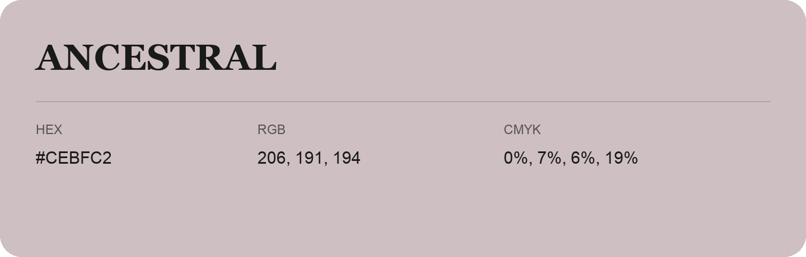

## Ancestral

- HEX: #CEBFC2
- RGB: 206, 191, 194
- CMYK: 0%, 7%, 6%, 19%
- Character: quiet, balanced, understated
- Suggested uses: professional services, minimal identities, supporting backgrounds

- Source images: IMG_9001.JPG
