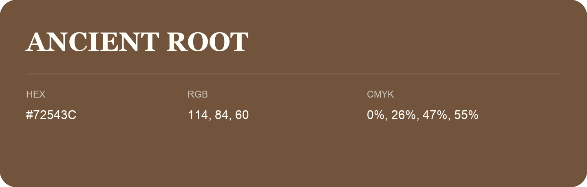

## Ancient Root

- HEX: #72543C
- RGB: 114, 84, 60
- CMYK: 0%, 26%, 47%, 55%
- Character: earthy, rich, warm
- Suggested uses: premium packaging, rustic brands, dark backgrounds

- Source images: iCloud Photos 2/IMG_9183.JPG
