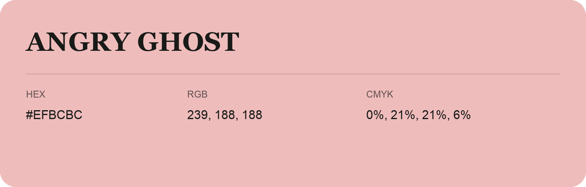

## Angry Ghost

- HEX: #EFBCBC
- RGB: 239, 188, 188
- CMYK: 0%, 21%, 21%, 6%
- Character: soft, warm, playful
- Suggested uses: friendly consumer brands, gentle backgrounds, welcoming accents

- Source images: iCloud Photos 2/IMG_9143.JPG
- Data provenance: RGB calculated from HEX; source text recognition was uncertain.
