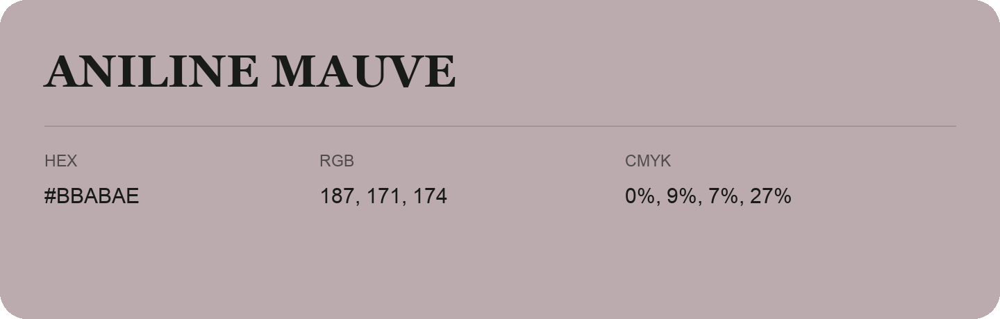

## Aniline Mauve

- HEX: #BBABAE
- RGB: 187, 171, 174
- CMYK: 0%, 9%, 7%, 27%
- Character: quiet, balanced, understated
- Suggested uses: professional services, minimal identities, supporting backgrounds

- Source images: IMG_9061.JPG

- Data provenance: HEX recovered from page data; cross-checked against the readable source RGB.
