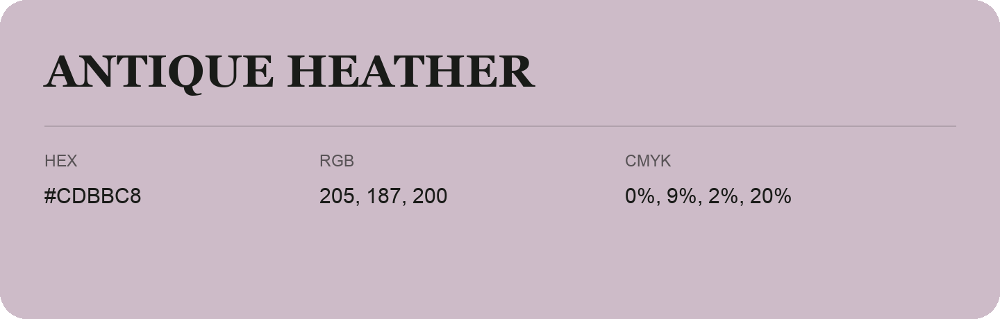

## Antique Heather

- HEX: #CDBBC8
- RGB: 205, 187, 200
- CMYK: 0%, 9%, 2%, 20%
- Character: quiet, balanced, understated
- Suggested uses: professional services, minimal identities, supporting backgrounds

- Source images: IMG_9096.JPG

- Data provenance: RGB calculated from HEX, matching the page; source image RGB was unreadable.
