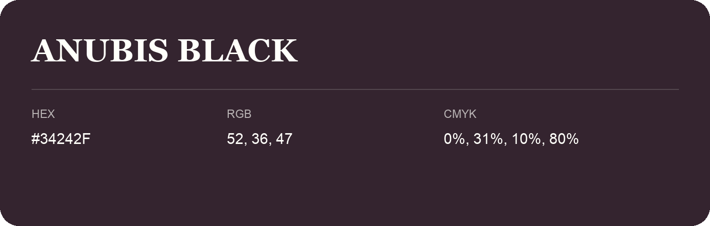

## Anubis Black

- HEX: #34242F
- RGB: 52, 36, 47
- CMYK: 0%, 31%, 10%, 80%
- Character: deep, grounded, understated
- Suggested uses: premium packaging, editorial typography, dark backgrounds

- Source images: iCloud Photos 2/IMG_9167.JPG
