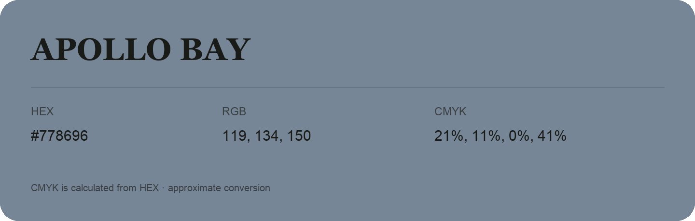

## Apollo Bay

- HEX: #778696
- RGB: 119, 134, 150
- CMYK: 21%, 11%, 0%, 41%
- Character: cool, composed, dependable
- Suggested uses: professional services, technology brands, calm backgrounds

- Source images: iCloud Photos 2/IMG_9186.JPG
- Data provenance: CMYK calculated from HEX; source text recognition was uncertain. Approximate conversion without a print color profile.
