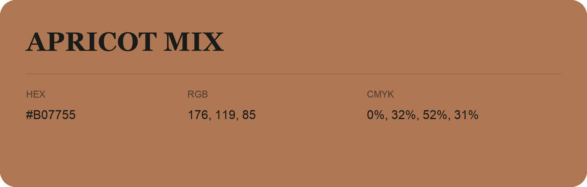

## Apricot Mix

- HEX: #B07755
- RGB: 176, 119, 85
- CMYK: 0%, 32%, 52%, 31%
- Character: earthy, rich, warm
- Suggested uses: artisan businesses, hospitality brands, warm accents

- Source images: IMG_9080.JPG
