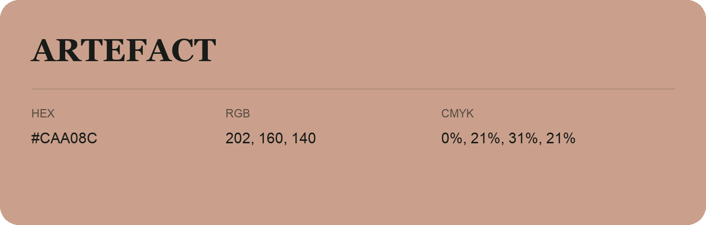

## Artefact

- HEX: #CAA08C
- RGB: 202, 160, 140
- CMYK: 0%, 21%, 31%, 21%
- Character: soft, warm, playful
- Suggested uses: friendly consumer brands, gentle backgrounds, welcoming accents

- Source images: IMG_9016.JPG
