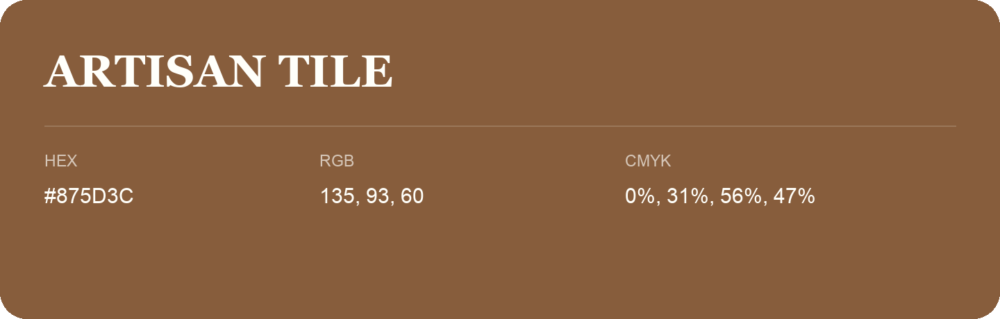

## Artisan Tile

- HEX: #875D3C
- RGB: 135, 93, 60
- CMYK: 0%, 31%, 56%, 47%
- Character: earthy, rich, warm
- Suggested uses: premium packaging, rustic brands, dark backgrounds

- Source images: IMG_9043.JPG
