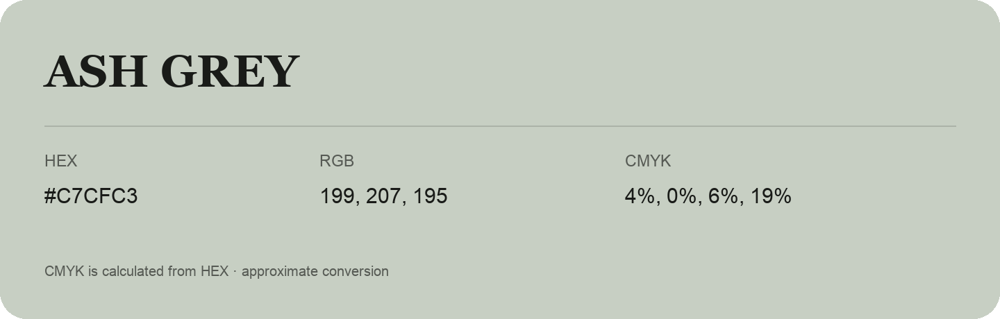

## Ash Grey

- HEX: #C7CFC3
- RGB: 199, 207, 195
- CMYK: 4%, 0%, 6%, 19%
- Character: quiet, balanced, understated
- Suggested uses: professional services, minimal identities, supporting backgrounds

- Source images: IMG_8985.JPG

- Data provenance: CMYK calculated from HEX using the page’s conversion; source image CMYK was unreadable. This is an approximate conversion without a print color profile.
