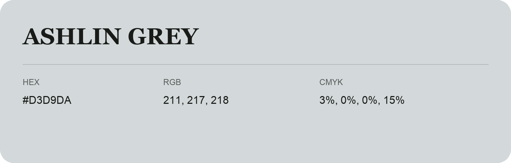

## Ashlin Grey

- HEX: #D3D9DA
- RGB: 211, 217, 218
- CMYK: 3%, 0%, 0%, 15%
- Character: quiet, balanced, understated
- Suggested uses: professional services, minimal identities, supporting backgrounds

- Source images: iCloud Photos 2/IMG_9157.JPG
