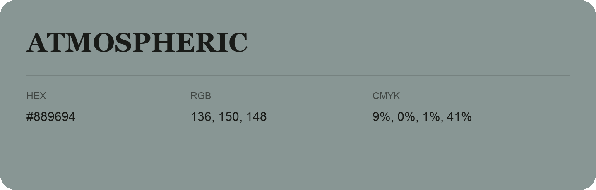

## Atmospheric

- HEX: #889694
- RGB: 136, 150, 148
- CMYK: 9%, 0%, 1%, 41%
- Character: quiet, balanced, understated
- Suggested uses: professional services, minimal identities, supporting backgrounds

- Source images: IMG_9004.JPG

- Name note: Other distinct shades share this name: [atmospheric-889698](atmospheric-889698.md).
