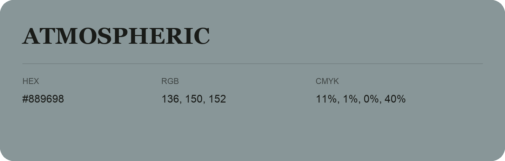

## Atmospheric

- HEX: #889698
- RGB: 136, 150, 152
- CMYK: 11%, 1%, 0%, 40%
- Character: quiet, balanced, understated
- Suggested uses: professional services, minimal identities, supporting backgrounds

- Source images: IMG_9047-1.JPG

- Name note: Other distinct shades share this name: [atmospheric-889694](atmospheric-889694.md).
