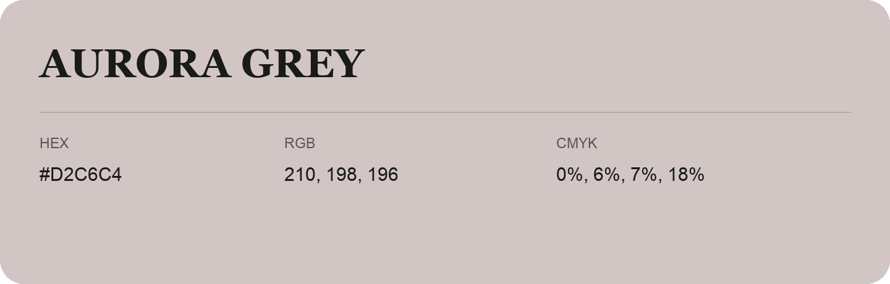

## Aurora Grey

- HEX: #D2C6C4
- RGB: 210, 198, 196
- CMYK: 0%, 6%, 7%, 18%
- Character: quiet, balanced, understated
- Suggested uses: professional services, minimal identities, supporting backgrounds

- Source images: IMG_9056.JPG

- Data provenance: RGB calculated from HEX, matching the page; source image RGB was unreadable.
