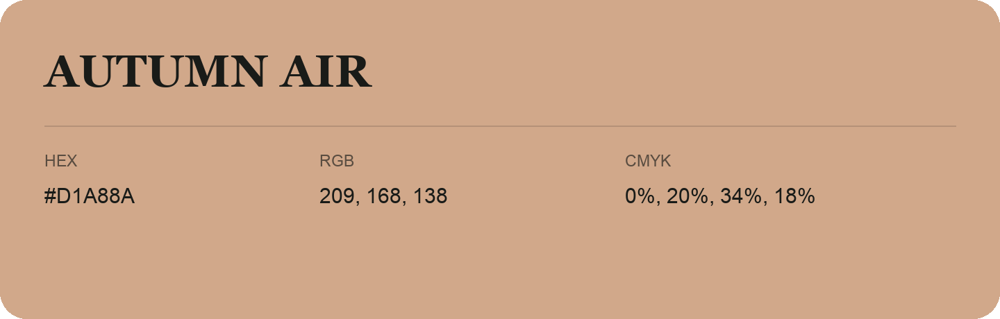

## Autumn Air

- HEX: #D1A88A
- RGB: 209, 168, 138
- CMYK: 0%, 20%, 34%, 18%
- Character: soft, gentle, approachable
- Suggested uses: friendly consumer brands, gentle backgrounds, welcoming accents

- Source images: IMG_9079.JPG
