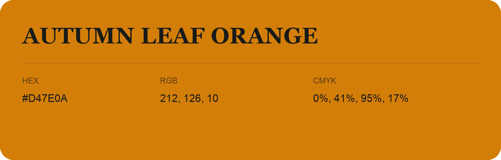

## Autumn Leaf Orange

- HEX: #D47E0A
- RGB: 212, 126, 10
- CMYK: 0%, 41%, 95%, 17%
- Character: earthy, rich, warm
- Suggested uses: artisan businesses, hospitality brands, warm accents

- Source images: IMG_9024.JPG

- Data provenance: HEX recovered from page data; cross-checked against the readable source RGB.
