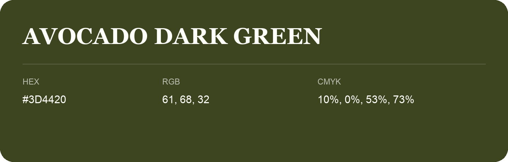

## Avocado Dark Green

- HEX: #3D4420
- RGB: 61, 68, 32
- CMYK: 10%, 0%, 53%, 73%
- Character: deep, grounded, understated
- Suggested uses: premium packaging, editorial typography, dark backgrounds

- Source images: IMG_9024.JPG

- Name note: Other distinct shades share this name: [avocado-dark-green-3f4a25](avocado-dark-green-3f4a25.md).
