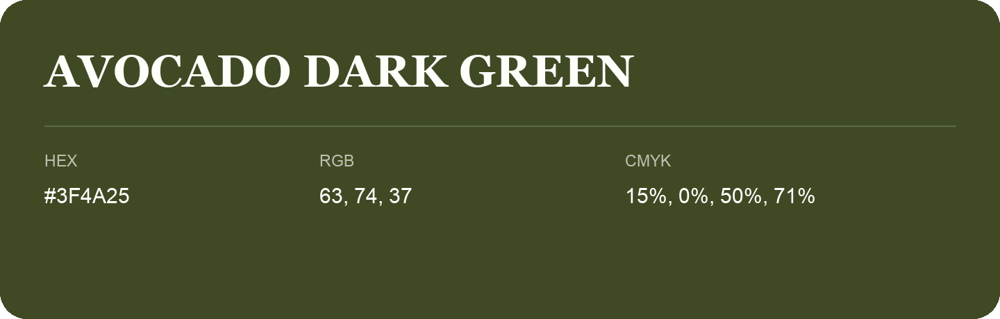

## Avocado Dark Green

- HEX: #3F4A25
- RGB: 63, 74, 37
- CMYK: 15%, 0%, 50%, 71%
- Character: deep, grounded, understated
- Suggested uses: premium packaging, editorial typography, dark backgrounds

- Source images: IMG_9053.JPG

- Name note: Other distinct shades share this name: [avocado-dark-green-3d4420](avocado-dark-green-3d4420.md).
