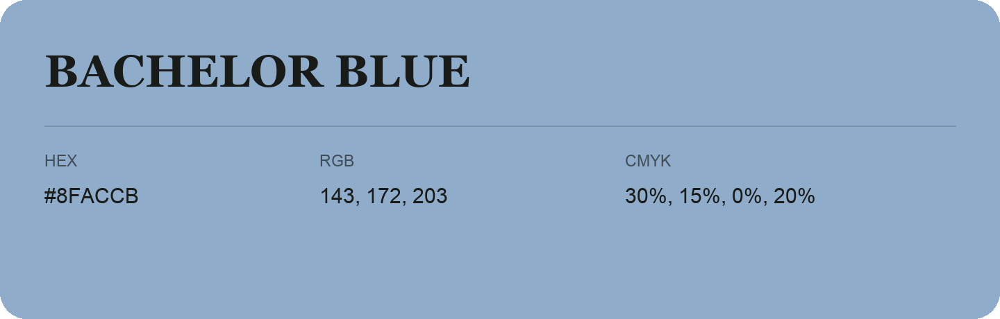

## Bachelor Blue

- HEX: #8FACCB
- RGB: 143, 172, 203
- CMYK: 30%, 15%, 0%, 20%
- Character: soft, gentle, approachable
- Suggested uses: friendly consumer brands, gentle backgrounds, welcoming accents

- Source images: iCloud Photos 2/IMG_9133.JPG
