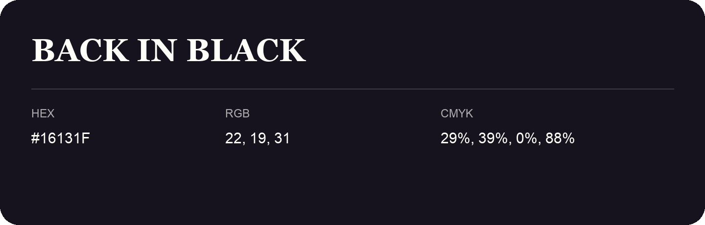

## Back In Black

- HEX: #16131F
- RGB: 22, 19, 31
- CMYK: 29%, 39%, 0%, 88%
- Character: cool, composed, dependable
- Suggested uses: professional services, technology brands, calm backgrounds

- Source images: IMG_9108.JPG
