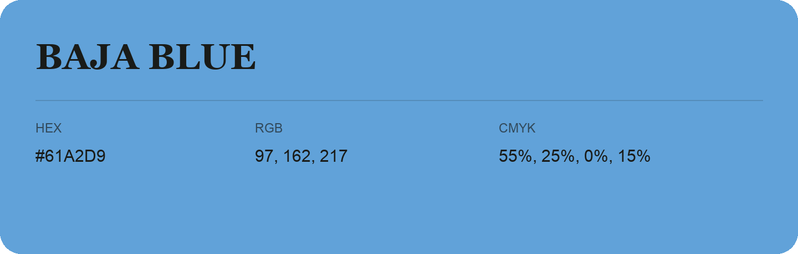

## Baja Blue

- HEX: #61A2D9
- RGB: 97, 162, 217
- CMYK: 55%, 25%, 0%, 15%
- Character: cool, composed, dependable
- Suggested uses: professional services, technology brands, calm backgrounds

- Source images: IMG_9042.JPG
