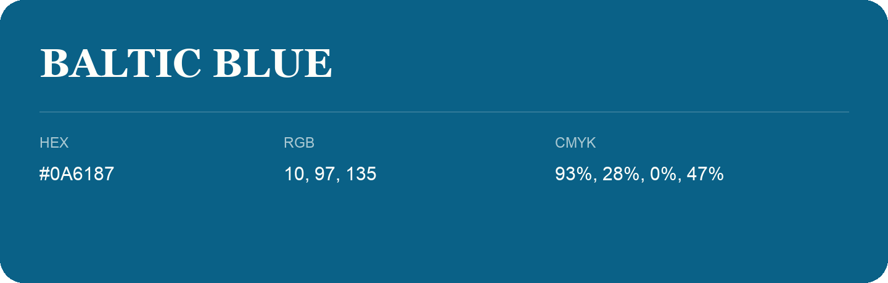

## Baltic Blue

- HEX: #0A6187
- RGB: 10, 97, 135
- CMYK: 93%, 28%, 0%, 47%
- Character: calm, fresh, composed
- Suggested uses: wellness brands, coastal hospitality, modern service brands

- Source images: IMG_8982.JPG
