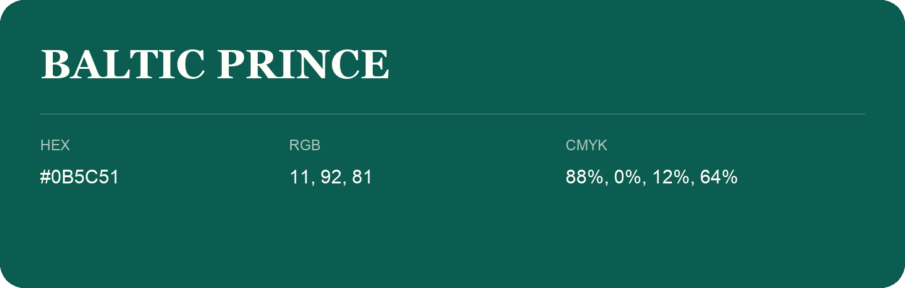

## Baltic Prince

- HEX: #0B5C51
- RGB: 11, 92, 81
- CMYK: 88%, 0%, 12%, 64%
- Character: calm, fresh, composed
- Suggested uses: wellness brands, coastal hospitality, modern service brands

- Source images: IMG_9060.JPG

- Data provenance: HEX recovered from page data; cross-checked against the readable source RGB.
