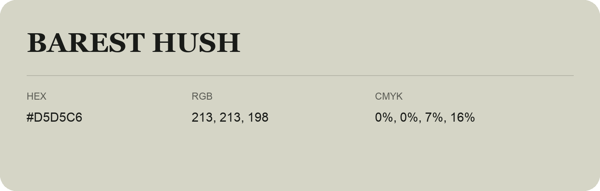

## Barest Hush

- HEX: #D5D5C6
- RGB: 213, 213, 198
- CMYK: 0%, 0%, 7%, 16%
- Character: quiet, balanced, understated
- Suggested uses: professional services, minimal identities, supporting backgrounds

- Source images: IMG_9078.JPG
