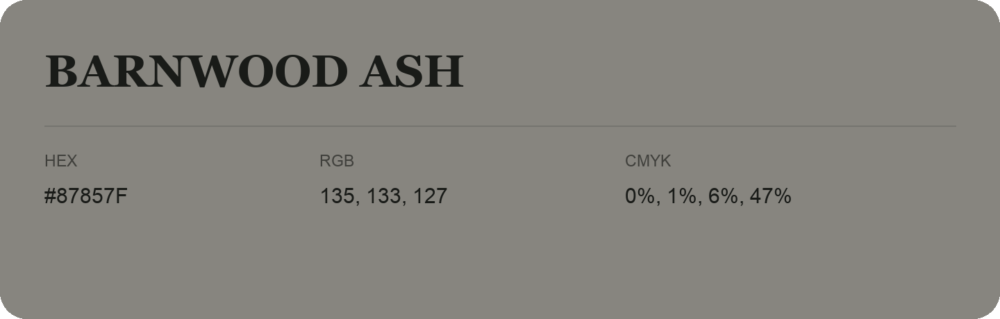

## Barnwood Ash

- HEX: #87857F
- RGB: 135, 133, 127
- CMYK: 0%, 1%, 6%, 47%
- Character: quiet, balanced, understated
- Suggested uses: professional services, minimal identities, supporting backgrounds

- Source images: IMG_8998.JPG
