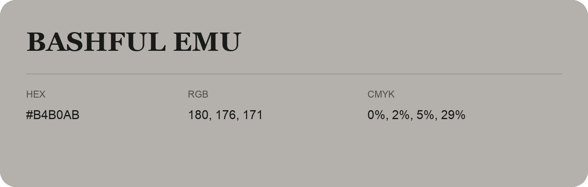

## Bashful Emu

- HEX: #B4B0AB
- RGB: 180, 176, 171
- CMYK: 0%, 2%, 5%, 29%
- Character: quiet, balanced, understated
- Suggested uses: professional services, minimal identities, supporting backgrounds

- Source images: IMG_9112.JPG

- Data provenance: HEX recovered from page data; cross-checked against the readable source RGB.
