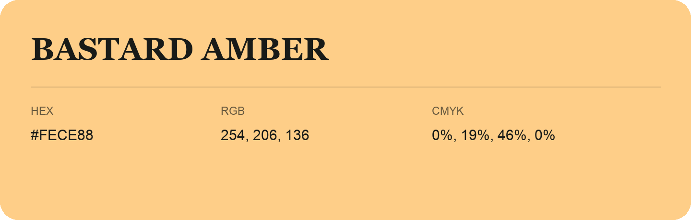

## Bastard Amber

- HEX: #FECE88
- RGB: 254, 206, 136
- CMYK: 0%, 19%, 46%, 0%
- Character: earthy, rich, warm
- Suggested uses: artisan businesses, hospitality brands, warm accents

- Source images: iCloud Photos 2/IMG_9155.JPG
- Data provenance: RGB calculated from HEX; source text recognition was uncertain.
