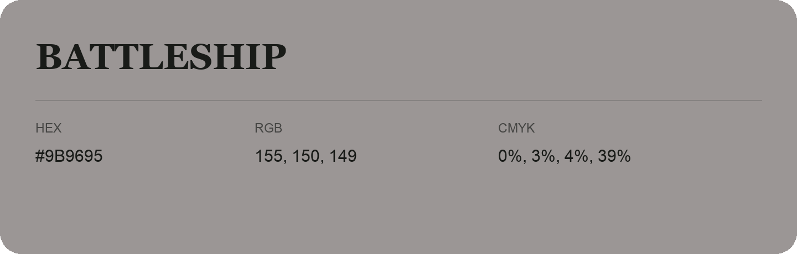

## Battleship

- HEX: #9B9695
- RGB: 155, 150, 149
- CMYK: 0%, 3%, 4%, 39%
- Character: quiet, balanced, understated
- Suggested uses: professional services, minimal identities, supporting backgrounds

- Source images: IMG_9045.JPG
