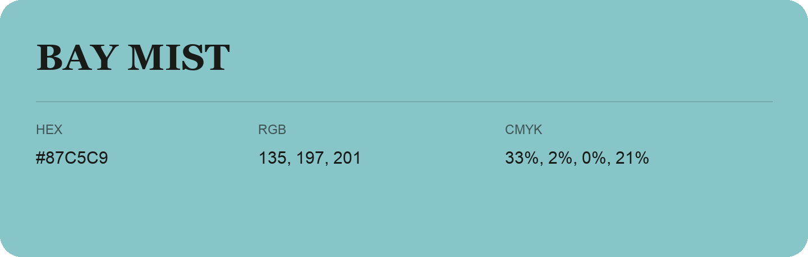

## Bay Mist

- HEX: #87C5C9
- RGB: 135, 197, 201
- CMYK: 33%, 2%, 0%, 21%
- Character: soft, gentle, approachable
- Suggested uses: friendly consumer brands, gentle backgrounds, welcoming accents

- Source images: IMG_9036.JPG

- Data provenance: RGB calculated from HEX, matching the page; source image RGB was unreadable.
