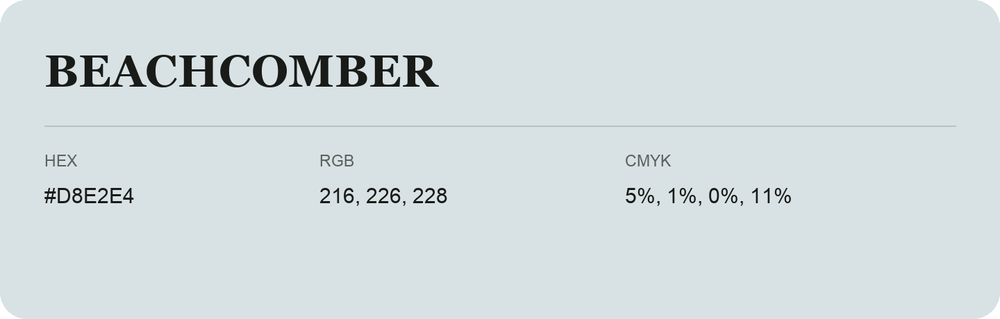

## Beachcomber

- HEX: #D8E2E4
- RGB: 216, 226, 228
- CMYK: 5%, 1%, 0%, 11%
- Character: quiet, balanced, understated
- Suggested uses: professional services, minimal identities, supporting backgrounds

- Source images: IMG_9021.JPG
