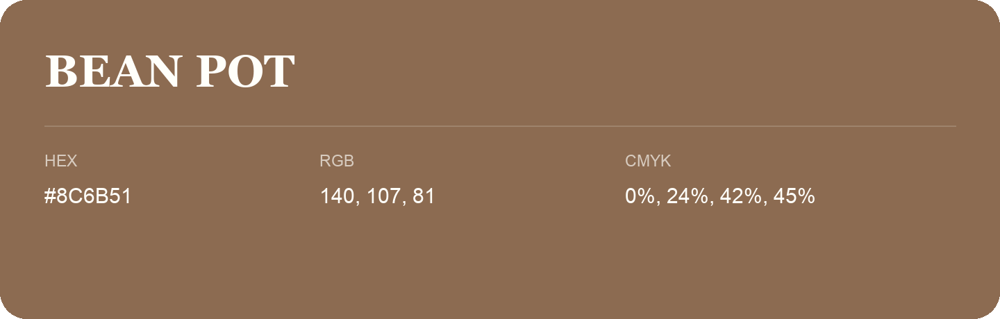

## Bean Pot

- HEX: #8C6B51
- RGB: 140, 107, 81
- CMYK: 0%, 24%, 42%, 45%
- Character: earthy, rich, warm
- Suggested uses: premium packaging, rustic brands, dark backgrounds

- Source images: IMG_9032.JPG
