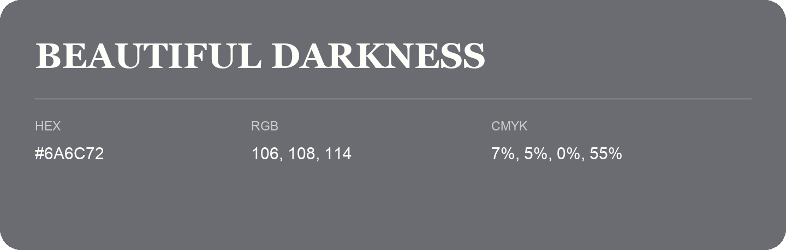

## Beautiful Darkness

- HEX: #6A6C72
- RGB: 106, 108, 114
- CMYK: 7%, 5%, 0%, 55%
- Character: restrained, grounded, sophisticated
- Suggested uses: premium brands, editorial typography, dark backgrounds

- Source images: IMG_9054.JPG
