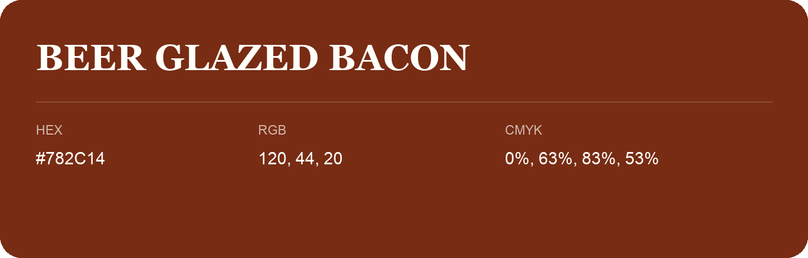

## Beer Glazed Bacon

- HEX: #782C14
- RGB: 120, 44, 20
- CMYK: 0%, 63%, 83%, 53%
- Character: warm, expressive, energetic
- Suggested uses: food brands, expressive identities, promotional accents

- Source images: iCloud Photos 2/IMG_9153.JPG
