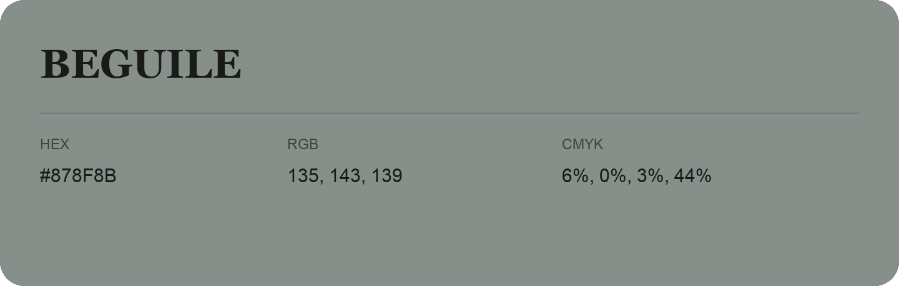

## Beguile

- HEX: #878F8B
- RGB: 135, 143, 139
- CMYK: 6%, 0%, 3%, 44%
- Character: quiet, balanced, understated
- Suggested uses: professional services, minimal identities, supporting backgrounds

- Source images: IMG_9039.JPG
